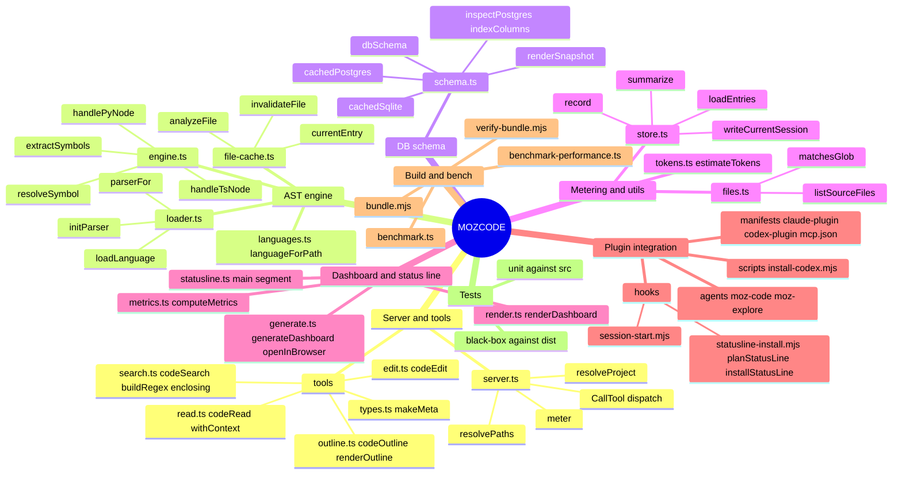

# MOZCODE: repository map

Base commit `b827622` (branch `repochad/2026-10-11`). MOZCODE v0.3.0 (`src/version.ts:10`). About 2,800 lines of TypeScript in `src/` (2,798 by `wc -l`), plus 10 test files with 72 passing cases (`.repochad/last_test.log`).
Area maps with file:line evidence are in `.repochad/map/*.md`. This document combines them.

## 1. Overview

MOZCODE is a clean-room rebuild of WOZCODE's token-saving technique (`README.md:13-17`). It ships as a local stdio MCP server (`dist/server.js`) for Claude Code and Codex. The server gives the model symbol-level tools (`code_outline`, `code_read`, `code_search`, `code_edit`) built on a tree-sitter AST, plus `db_schema`, which returns a whole SQLite or Postgres schema in one call. The model gets one function, an outline or a grouped search hit instead of a whole file, so each turn carries fewer tokens. A SessionStart hook pushes the model toward these tools and installs a status line. Every tool call appends a counterfactual "tokens saved" record to a JSONL ledger under `~/.mozcode`, and that ledger drives a `$ / tokens / round-trips` status line and an HTML dashboard. The plugin ships pre-bundled: esbuild inlines all dependencies into `dist/`, the WASM grammars are committed in `grammars/`, and the user never runs a build step.

## 2. Architecture

```
 Host (Claude Code / Codex)
   │  stdio JSON-RPC                        SessionStart hook ──► nudge text + ~/.claude/settings.json statusLine
   ▼                                        (hooks/session-start.mjs, hooks/statusline-install.mjs)
 src/server.ts  ── resolveProject / resolvePaths ── switch(tool) ── meter() ──► src/metering/store.ts ──► ~/.mozcode/metering/<proj>-<sha>.jsonl
   │                                                                                                        │
   ├─ src/tools/{outline,read,search,edit}.ts                                                               ├─► src/statusline.ts (new node process per refresh)
   │     └─ src/ast/file-cache.ts (stat-keyed source + analysis memo, 64 MiB)                               └─► src/dashboard/{generate,metrics,render}.ts → dashboard.html
   │           └─ src/ast/engine.ts (CST walk → Symbol[]) ── src/ast/loader.ts (web-tree-sitter WASM) ── grammars/*.wasm
   ├─ src/db/schema.ts (node:sqlite | sqlite3 CLI | pg) with per-path / per-env caches
   └─ src/util/{files,tokens}.ts (tree walk + glob; o200k BPE token counts)
```

- **Process model.** A single Node process runs single-threaded, one per host session. Every CPU-heavy step runs synchronously on the event loop that also serves stdio: tree-sitter `parse()`, BPE token counting, the JS `RegExp` scan in `code_search` and `DatabaseSync`. One slow call therefore stalls every later call (`map/ast-engine.md`, `map/metering-util.md`).
- **State.** All state is in memory: the parse cache (`file-cache.ts`), the db snapshot caches (`schema.ts:71-72`), and the memoised grammar `Language` objects (`loader.ts:57-67`). The only persistent state is `~/.mozcode` (or `MOZCODE_HOME`), which holds the metering JSONL files, the session pointer files and `dashboard.html`.
- **Project resolution.** `MOZCODE_PROJECT` takes priority, then cwd. When cwd is the plugin root (Codex) and `MOZCODE_TRUST_CWD` is not set, the server fails closed: every tool except `moz_status` and absolute paths returns UNRESOLVED (`server.ts:38-57,232-236`).
- **Packaging.** `scripts/bundle.mjs` uses esbuild to target node18 and produce `dist/server.js` and `dist/statusline.js`, and copies the WASM grammars. Users run the committed `dist/` directly. The black-box tests also run the committed `dist/`, not `src/` (`map/tests.md`).

### Comparison with WOZCODE: responsiveness and efficiency

These are the techniques MOZCODE copies, and where each copy is weaker than the original:

| WOZCODE technique | MOZCODE implementation | Gap that costs latency or tokens |
|---|---|---|
| Outline first, then read one symbol | `code_outline` / `code_read` with a stat-keyed parse cache (`file-cache.ts:35-81`) | Warm calls are fast. Cold calls parse synchronously with no size cap. The whole file is BPE-tokenized on every call only to compute the baseline (`tokens.ts:16`, `read.ts:25`). WASM Parser and Tree objects leak (`loader.ts:70-76`, `engine.ts:225-230`). |
| Grep grouped by symbol | `code_search` (`search.ts:37`) | No ripgrep (the spec promised it, `spec:69`). The tree is walked serially with no cached index and each file is awaited one at a time. `path_glob` is broken. Results are cut off at 200 matches and 5000 files without telling the model. |
| Edit by symbol, no re-read | `code_edit` splices the AST span and checks that the result still parses (`edit.ts:8-42`) | Ambiguous bare names, multi-declarator spans and a weak parse check can all hit the wrong code. Failures come back with `isError:false`. |
| Nudge the model toward the tools, route cheap scans to Haiku | SessionStart hook, `agents/moz-explore.md` (`model: haiku`) | The nudge is lost after `/clear` or compaction (`hooks.json:5`). The `moz-explore` subagent does run on Haiku once invoked (frontmatter `model: haiku`), but whether the main model delegates to it is only a prompt-level suggestion. |
| Instant savings status line | `dist/statusline.js` runs every 5 s | Each refresh re-parses the full ledger for all projects, so the cost grows with lifetime usage (`statusline.ts:66`, `store.ts:91`). |
| One call returns the whole DB schema | `db_schema` with single-flight caches | The output has no cap or pagination. `DatabaseSync` blocks the event loop. The env var name is chosen by the model. |

## 3. Areas

| Area | Paths | What it does | Map |
|---|---|---|---|
| Server & tools | `src/server.ts`, `src/tools/*.ts`, `src/version.ts` | MCP entry point. Defines the 8 tool descriptors, resolves the project and paths, dispatches calls and meters them. Contains the four `code_*` tool implementations. | `map/server-tools.md` |
| AST engine | `src/ast/{engine,file-cache,languages,loader}.ts` | Loads the tree-sitter WASM runtime and grammars, turns the CST into a flat `Symbol[]` (TS/TSX/JS/Py), resolves symbol names, and memoises source and analysis keyed by mtime+size. | `map/ast-engine.md` |
| DB schema | `src/db/schema.ts` | Inspects SQLite (native, or CLI as fallback) and Postgres metadata, builds a snapshot that does not depend on the dialect, caches it, and renders one compact line per object. | `map/db-schema.md` |
| Metering & utils | `src/metering/store.ts`, `src/util/{tokens,files}.ts` | Keeps the JSONL savings ledger, the session pointer and the `summarize` aggregator. Counts tokens with o200k BPE. Provides the source-file walk and the glob matcher. | `map/metering-util.md` |
| Dashboard & status line | `src/dashboard/*.ts`, `src/statusline.ts` | Derives $, time and round-trips from token savings under fixed assumptions. Renders the HTML dashboard and the ANSI status line. | `map/dashboard-statusline.md` |
| Plugin integration | `.claude-plugin/`, `.codex-plugin/`, `.mcp.json`, `hooks/`, `agents/`, `commands/`, `skills/`, `scripts/install-codex.mjs` | Host manifests, the SessionStart nudge, the status line self-installer, Codex registration, and the prompt-level agents, commands and skills. | `map/plugin-integration.md` |
| Build & benchmarks | `scripts/*.{mjs,ts}`, `package.json`, `tsconfig.json`, `vitest.config.ts` | esbuild bundle, an orphaned bundle verifier, and benchmarks for token savings and latency. | `map/build-bench.md` |
| Tests | `test/*.test.ts`, `test/fixtures/` | Unit tests against `src/`, and black-box stdio tests against the committed `dist/`. 10 files, 72 cases. No CI. | `map/tests.md` |
| Docs | `README.md`, `docs/superpowers/specs/2026-07-24-mozcode-design.md` | User contract and the original MVP spec. Both have drifted from the code (9 findings). | `map/docs.md` |

## 4. Key flows

### Flow A: `code_read` / `code_outline`, the token-saving hot path
1. The host sends `tools/call`. `server.ts:227` runs the UNRESOLVED guard (`:232-236`), then `resolvePaths(String(args.path))` (`:60`). The path is not confined to the project.
2. `codeRead` (`read.ts:23`) calls `analyzeFile(abs)` (`file-cache.ts:69`). `currentEntry` runs `fs.stat` on every call. If mtime and size match, it reuses the cached `source` and `analysis` promises. Otherwise it calls `readFile`, then `trim()` to the 64 MiB budget (`file-cache.ts:28-61`).
3. On a cache miss, `extractSymbols` (`engine.ts:224`) gets a **new** `Parser` from `parserFor` (`loader.ts:70`), runs a synchronous `parse`, and walks the tree with `handleTsNode` or `handlePyNode`. Nothing calls `delete()`.
4. `resolveSymbol` (`engine.ts:234`) tries an exact qualified name first, then the first bare-name match. `withContext` slices the lines (`read.ts:13`). If the symbol is missing, the tool returns the outline, marked degraded. Unsupported languages get the whole file, numbered, with no size cap.
5. `estimateTokens(source)` runs the baseline BPE over the whole file and `estimateTokens(text)` gives the actual count. `makeMeta` builds the savings record (`types.ts:20`). `meter()` **awaits** `record()`, which runs `mkdir` and `appendFile` on the JSONL file (`server.ts:68`, `store.ts:34`), and only then does `textResult` reply.

### Flow B: `code_search`
1. `codeSearch(PROJECT, query, path_glob)` (`search.ts:37`) compiles `buildRegex(query)` straight from model input, with an escaped literal as the fallback (`:18`).
2. `listSourceFiles(root)` (`files.ts:13`) runs a serial DFS on every call. It skips dot directories and a fixed name list (`node_modules`, `dist`, `build`, `coverage`, `__pycache__` and a few more, `files.ts:4-6`; `vendor/`, `out/` and `target/` are still scanned), ignores `.gitignore`, and stops silently at 5000 files. `matchesGlob(absPath, glob)` (`files.ts:39`) is anchored to the start of the string and receives absolute paths, so `src/**/*.ts` never matches (**verified during synthesis**: the scoped search returns "No matches" and the unscoped search returns 5 matches).
3. Each file is loaded one at a time with `await readCachedSource` and scanned line by line with `rx.exec`. The scan stops at `MAX_MATCHES = 200` (`:61,65`) with no truncation marker.
4. For each file that has hits, `analyzeFile` and `enclosing()` group the hits under the innermost symbol (`:27,97`). The tool then meters the call and replies.

### Flow C: `code_edit`
1. `codeEdit` (`edit.ts:8`) runs `analyzeFile` and then `resolveSymbol` (taking the first bare-name match), and builds `next = source[0:startIndex] + new_source + source[endIndex:]` (`:29`).
2. It re-parses `next` with an uncached `extractSymbols` call, which leaks one more Parser and Tree. It rejects the edit only if the original file parsed cleanly and `next` does not (`:32-36`).
3. `fs.writeFile` writes the file in place, which is not atomic (`:38`). `invalidateFile` follows (`:39`). The server sets `isError` only when the message contains "rejected" (`server.ts:257`). Every outcome, including failures, is metered, and `computeMetrics` counts each one as an avoided round trip (`metrics.ts:51-58`).

### Flow D: metering → status line and dashboard
1. Each tool call appends one `MeteringEntry` line to `~/.mozcode/metering/<base>-<sha1:12>.jsonl` (`store.ts:27-54`). At startup `main()` writes the per-project session pointer (`server.ts:304-307`, `store.ts:71`).
2. Claude Code starts `node dist/statusline.js` every 5 s (`statusline-install.mjs:28`). `main()` reads stdin and calls `loadEntries()`, which reads every project's whole ledger (`store.ts:91`). It filters with `e.project === cwd`, chooses the session from the pointer, and runs `summarize` and `computeMetrics` twice (for this session and for all time) (`statusline.ts:57-85`).
3. `moz_dashboard` runs `generateDashboard` (`generate.ts:23`): `loadEntries`, `summarize` and `renderDashboard` (`render.ts:148`), then writes `dashboard.html` and calls `openInBrowser`, which spawns a child with no `'error'` listener (`generate.ts:33`). `moz_savings` calls `loadEntries()` twice (`server.ts:269-270`).

### Flow E: install and session start
1. **Claude Code.** `.claude-plugin/plugin.json` launches `node ${CLAUDE_PLUGIN_ROOT}/dist/server.js` with the workspace as cwd. `hooks/hooks.json` (matcher `startup|resume`) runs `session-start.mjs`, which calls `installStatusLine` (read settings, plan the change, write a temp file and rename it over `~/.claude/settings.json`) and prints `additionalContext` that pushes the model toward the `code_*` tools.
2. **Codex.** `.mcp.json` sets `cwd "."`, which resolves to the plugin root, so the server reports UNRESOLVED until the user runs `scripts/install-codex.mjs`. That script runs `codex mcp remove` and then `codex mcp add` with `MOZCODE_TRUST_CWD=1`. The skill in `skills/mozcode/SKILL.md` is the only nudge Codex gets.

## 5. Mindmap



## 6. Hot spots (ranked)

Duplicate reports from the area maps are merged. The ranking puts correctness and user-visible harm first, then security, then scale and responsiveness. "Verified" means the finding was re-run during this synthesis.

| # | Sev | Cat | Where | Issue |
|---|---|---|---|---|
| 1 | high | quality | `src/util/files.ts:39-52` + `src/tools/search.ts:47` | **`path_glob` is broken.** The anchored glob regex is run against absolute paths, so the schema's own example `src/**/*.ts` (`server.ts:128`), `*.ts` and `src/tools/*.ts` all return "No matches". `**/` requires at least one extra directory. The `endsWith` fallback over-matches (`ad.ts` matches `read.ts`), and `?` is not escaped. **Verified.** There is no test for it. |
| 2 | high | scale | `src/ast/loader.ts:70-76`, `src/ast/engine.ts:225-230` | **WASM memory leak.** A new `Parser` is created on every call, and neither `tree.delete()` nor `parser.delete()` is ever called (confirmed: there are no `.delete()` calls in `src/` apart from Map deletes). Every cache miss and every `code_edit` validation grows the WASM heap of the long-lived server, and that heap never shrinks. |
| 3 | high | quality | `test/codex-compat.test.ts:52`, `scripts/benchmark.ts:77,89,103` | **Tests and benchmarks write into the user's real `~/.mozcode`** because they do not set `MOZCODE_HOME`. The real dashboard and status line show inflated numbers. |
| 4 | high | quality | `src/dashboard/render.ts:314`, `README.md:144` | **The shipped "auditable assumptions" say ~4 chars/token**, but the counts come from o200k BPE (`src/util/tokens.ts:16-19`). chars/4 is only used as a fallback when an exception is caught. |
| 5 | medium | security | `src/tools/search.ts:18-24,56-58` | **ReDoS.** The model-supplied regex is compiled with no limits and runs synchronously over up to 5000 files with no timeout, so it can freeze the single-threaded server. The spec promised ripgrep (`spec:69`). |
| 6 | medium | security | `src/server.ts:60-66,254-256`, `src/db/schema.ts:447` | **No path containment.** `code_edit`, `code_read` and `db_schema` accept absolute paths and `../` traversal outside the project, and absolute paths are accepted even when the project is UNRESOLVED. No test covers this. |
| 7 | medium | security | `src/db/schema.ts:367`, `src/server.ts:299` | **`connection_env` can name any env var.** A prompt injection can send any secret to pg's URL parser or to a network host. MOZCODE's own error text echoes only the variable name (`schema.ts:369`); whether the value leaks depends on pg's error messages (not verified). An allow-list or a URL-shape check would close this. |
| 8 | medium | quality | `src/ast/engine.ts:141,144,234-239`, `src/tools/edit.ts:22,33` | **`code_edit` can rewrite the wrong code silently.** A bare-name lookup takes the first match (constructor, repeated methods, overloads, nested Python classes). In multi-declarator `const a=1, b=…` statements, each symbol spans the whole statement, so its siblings are overwritten too. The parse check is skipped when the file already had errors, and nothing checks that `new_source` still defines the symbol. |
| 9 | medium | scale | `src/metering/store.ts:91`, `src/statusline.ts:66`, `src/server.ts:269-270` | **The ledger read cost grows with lifetime usage.** Every 5 s status refresh re-reads and parses the ledgers for all projects (twice for `moz_savings`). Nothing rotates, rolls up or tail-reads the ledger. Lines are not shape-checked, so a single `null` line makes the status line silently show $0.00. |
| 10 | medium | scale | `src/tools/search.ts:43-66`, `src/util/files.ts:13` | **Slow cold search.** The tree is walked serially on every query with no file index, and up to 5000 files are read one at a time. Search stops silently at 5000 files and at 200 matches (the header says "200 matches" with no truncation flag), and `.gitignore` is ignored. |
| 11 | medium | scale | `src/util/tokens.ts:16`, `src/ast/file-cache.ts:28-49`, `src/ast/engine.ts:226`, `src/db/schema.ts:173,189` | **Synchronous CPU work on the request path.** The whole-file BPE baseline runs on every call and is never cached. Parsing has no size cap or timeout, and the 64 MiB budget ignores UTF-16 doubling and WASM trees. `DatabaseSync` blocks, and the `sqlite3` CLI call has no timeout. |
| 12 | medium | quality | `src/ast/loader.ts:47-65`, `src/ast/file-cache.ts:71-79` | **Rejected promises are cached.** `initPromise` and `languageCache` keep a rejection for the life of the process, so one transient failure disables AST features (or one language) until the server restarts. A rejected `entry.analysis` is narrower: it sticks only until that file's mtime/size changes or the entry is evicted (`file-cache.ts:38,45`). |
| 13 | medium | quality | `src/dashboard/generate.ts:33-40` | **`openInBrowser` has no `'error'` listener.** If `xdg-open` is missing, the unhandled error can crash the MCP server. On Windows, `start` is run with an unquoted path through a shell. |
| 14 | medium | quality | `hooks/hooks.json:5` | **The nudge is lost after `/clear` or compaction** because the matcher is `startup|resume`. Long sessions drift back to Read and Grep, which removes MOZCODE's main efficiency lever. |
| 15 | medium | scale | `src/tools/read.ts:29-38`, `src/db/schema.ts:425` | **No output caps.** For unsupported languages `code_read` returns the whole file, and `db_schema` returns every table. Both can cost more tokens than the built-in tools. |
| 16 | medium | quality | `test/integration.test.ts:11`, `test/statusline.test.ts:9`, `package.json`, no `.github/` | **The black-box tests run the committed `dist/`** with no pretest build. There is no CI and no `engines` field, although the bundle targets node18 and the native SQLite path needs Node 22.12+ by the code's own error text (`schema.ts:210`). `node:sqlite` first appeared in 22.5 behind `--experimental-sqlite`, and `db_schema` falls back to the `sqlite3` CLI when the import fails (`schema.ts:174,199-206`). `scripts/` and `test/` are not typechecked. |
| 17 | medium | quality | `src/server.ts:257`, `src/dashboard/metrics.ts:51-58` | **Failed `code_edit` calls are reported as successes** (`isError:false` for "symbol not found" and "unsupported language") and are counted as avoided round trips, which inflates calls, cost and time saved. |
| 18 | medium | quality | `src/db/schema.ts:287,219` | Postgres `indexColumns` parses `indexdef` with a regex, so expression, opclass, DESC and INCLUDE indexes come out wrong, and the Postgres path has no tests. The SQLite cache misses schema changes that are still in the WAL file. |
| 19 | medium | quality | `scripts/bundle.mjs:11,14`, `scripts/verify-bundle.mjs` | The build deletes `dist/` before esbuild runs and resolves paths from cwd. The bundle verifier is not wired into any script and never checks `statusline.js`. |
| 20 | medium | quality | `hooks/statusline-install.mjs:41-47,92-124` | The rename replaces a symlinked `settings.json` with a regular file and resets its mode. `isOurs` is a substring check that can claim a user's own status line. The read-modify-write is unlocked. |
| 21 | medium | quality | `docs/superpowers/specs/…`, `README.md:149-176` | The spec is stale (it still describes a PostToolUse hook, `.scm` queries and the Haiku non-goal). The README says the build is "tsc + bundle" and its architecture tree is incomplete. |
| 22 | low | various | see the area maps | `context_lines` is not validated (`read.ts:13`). The write is not atomic (`edit.ts:38`). `meter()` awaits disk I/O (`server.ts:68`). `byFile` merges across projects. The session pointer is last-writer-wins. Ledger files use the default umask. `fmtDuration` can print "1m 60s". All sparklines reuse one series. `p.day` is not escaped. `localStorage` calls have no try/catch. `--series-0`. Codex re-registration is not atomic. `URL.pathname` is used where `fileURLToPath` is needed. The benchmark has hard-coded "69 → 4" literals. `dash-preview.html` is not gitignored. `readFileSafe` is dead code. Test temp files leak. The `callTool` harness is fragile. The 150 ms timing assertion can flake. |

### Disputed finding (not reproduced)
- **"`code_edit` splices with UTF-8 byte offsets"** (`edit.ts:29`, `search.ts:30`, `engine.ts:28-29`, reported as high). **This could not be reproduced during synthesis.** With web-tree-sitter 0.25.10 and the source `// héllo wörld — ünïcode 😀😀\nexport function a()…`, `extractSymbols` returned `startIndex` 37, which is the correct JS (UTF-16) index. `codeEdit` replaced `a` correctly when run from `src/` with tsx and when run through the shipped `dist/server.js` over stdio, and `b` was left intact. This matches the doc comment at `engine.ts:14` ("UTF-16 offsets into the source"). Treat the finding as unconfirmed. A regression test with a non-ASCII fixture is still worth adding, but no fix should be built on this claim.

## Fact-check log

Each claim below was checked against the code at `b827622`. Claims shown as "Wrong" or "Imprecise" were corrected in place.

| # | Claim (source) | Verdict | Evidence / fix |
|---|---|---|---|
| 1 | "12 test files with 72 passing cases" (MAP header) | **Wrong** | `ls test/*.test.ts` gives 10, and `last_test.log` says "Test Files 10 passed". Changed to 10. Also added "10 files" to the Tests row. |
| 2 | "About 2,400 lines of TypeScript in `src/`" (MAP header) | **Wrong** | `wc -l src/**/*.ts src/*.ts` gives 2,798. Changed to about 2,800. |
| 3 | `path_glob` is anchored, runs against absolute paths, `**/` needs an extra directory, `endsWith` over-matches, `?` is not escaped (Hot spot 1) | Confirmed | `files.ts:41-51`, `search.ts:47`, and `server.ts:128` gives the example `src/**/*.ts`. |
| 4 | A new Parser on every call, no `.delete()` anywhere (Hot spot 2) | Confirmed | `loader.ts:73`, `engine.ts:225-226`. `grep "delete()" src` finds only Map deletes. |
| 5 | Rejected promises (`initPromise`, `languageCache`, `entry.analysis`) are cached forever (Hot spot 12, ast-engine.md) | **Imprecise** | This holds for `initPromise` and `languageCache`. `entry.analysis` is dropped when stat metadata changes or the entry is evicted (`file-cache.ts:38,45`). Reworded in MAP, ast-engine.md and EXPLAINED item 12. |
| 6 | The dashboard and README say "~4 chars/token" while counts use o200k BPE (Hot spot 4) | Confirmed | `render.ts:314`, `README.md:144`, `tokens.ts:1,19,23`. |
| 7 | `code_edit` failures return `isError:false` and still count as avoided round trips (Hot spot 17, Flow C) | Confirmed | `server.ts:257` only flags "rejected". `edit.ts:17-27` "not found" and "unsupported" messages do not contain it. `metrics.ts:51,58` counts every `code_edit` call. |
| 8 | The parse check is skipped when the original file already had errors, and multi-declarator `const` spans the whole statement (Hot spot 8) | Confirmed | `edit.ts:33` `breaksNow && !hadError`. `engine.ts:141,144` passes the whole `node` (the declaration) for every declarator. |
| 9 | `moz_savings` calls `loadEntries()` twice, and the status line reads every project's ledger (Hot spot 9, Flow D) | Confirmed | `server.ts:269-270`, `statusline.ts:66,71`, `store.ts:91-111`. |
| 10 | A `null` ledger line makes the status line show $0.00 (Hot spot 9) | Confirmed | `JSON.parse("null")` is pushed unchecked (`store.ts:105`), `summarize` throws on `e.baselineTokens`, and `statusline.ts:82-84` prints the $0.00 fallback. |
| 11 | `openInBrowser` has no `'error'` listener (Hot spot 13) | Confirmed | `generate.ts:36-37`. The try/catch cannot catch the async spawn `'error'` event. |
| 12 | The SessionStart matcher is `startup\|resume`, so the nudge is lost after `/clear` or compaction (Hot spot 14) | Confirmed | `hooks/hooks.json:5`. |
| 13 | The status line refreshes every 5 s (Flow D) | Confirmed | `statusline-install.mjs:28` `REFRESH_INTERVAL_SEC = 5`. |
| 14 | `codex-compat` tests and benchmarks write into the real `~/.mozcode` (Hot spot 3) | Confirmed | `codex-compat.test.ts:52` env has no `MOZCODE_HOME`, and the spawned server writes its session pointer (`server.ts:307`). `benchmark.ts:77,89,103` calls `record()` with no override. |
| 15 | `bundle.mjs` deletes `dist/` before esbuild runs, resolves paths from cwd, targets node18; there is no CI and `test/` is not typechecked (Hot spots 16, 19) | Confirmed | `bundle.mjs:11,14,23`. No `.github/`. `tsconfig.json:17-18` includes only `src` and excludes `test`. |
| 16 | "Haiku routing is a suggestion in the prompt only" (MAP comparison table, plugin-integration.md) | **Imprecise** | `agents/moz-explore.md:4` really pins the subagent to `model: haiku`. Only the main model's decision to delegate is prompt-level. Reworded in MAP, plugin-integration.md and EXPLAINED Gaps. |
| 17 | The `connection_env` secret "may be echoed in the error text" (Hot spot 7) | **Imprecise** | MOZCODE's own error echoes only the variable name (`schema.ts:369`). Leakage through pg's own errors is unverified. Reworded. |
| 18 | "Keeps up to 64 MiB of these indexes in memory" (EXPLAINED walk-through step 4) | **Imprecise** | The budget counts source `stat.size` only (`file-cache.ts:18,52`), not the indexes. Reworded. |
| 19 | The spec promised ripgrep, a PostToolUse hook and `.scm` queries; the README says "tsc + bundle" (Hot spots 5, 21) | Confirmed | `spec:69` ("Ripgrep for hits"), PostToolUse (`spec:32,107`), `.scm` (`spec:77,156`), Haiku as a non-goal (`spec:37`), `README.md:176` "tsc + bundle". |
| 20 | `db_schema` accepts absolute paths and `../` outside the project (Hot spot 6) | Confirmed | `schema.ts:447`, `server.ts:61`. The UNRESOLVED guard lets absolute paths through (`server.ts:232-236`). |

### Fact-check, round 2

These claims were checked against the code at `b827622` (a `git archive` snapshot), using the area maps and EXPLAINED as well as MAP. Runtime checks ran `extractSymbols` from the base `src/` with tsx against the repo's `node_modules` (web-tree-sitter 0.25.10).

| # | Claim (source) | Verdict | Evidence / fix |
|---|---|---|---|
| 21 | "The `code_edit` splice uses UTF-8 byte offsets" (high), and "`enclosing()` spans drift after non-ASCII text" (server-tools.md) | **Wrong** | The area map had kept the claim that MAP marks as disputed. Re-run: after `// héllo wörld — ünïcode 😀😀\n`, `a` has `startIndex` 37 and the slice is exactly `function a() { return 1; }`. Search offsets are also UTF-16 (`search.ts:54-63`). Both bullets and the "Notes" line in server-tools.md were rewritten as refuted. |
| 22 | "`node:sqlite` needs Node ≥22.5" (Hot spot 16, tests.md, build-bench.md) | **Imprecise** | The code's own error asks for Node 22.12+ (`schema.ts:210`). In 22.5 the module exists only behind a flag. `db_schema` imports it dynamically and falls back to the `sqlite3` CLI (`schema.ts:174,199-206`), so the tool does not "fail at import" on Node 20. Only the tests and the benchmark do. Reworded in MAP, tests.md and build-bench.md. |
| 23 | "MOZCODE's own test showed this replaces 69 separate lookups … with about 4" (EXPLAINED) | **Imprecise** | It comes from a benchmark script, not a test. "69 → 4" counts SQL metadata queries and is a hard-coded literal (`benchmark-performance.ts:193,203`). Seen from the agent, the reduction is 69 → 1 tool call (`:206`). Reworded. |
| 24 | `listSourceFiles` "skips … vendored directories" (MAP Flow B, server-tools.md) | **Imprecise** | It skips dot directories plus a fixed `IGNORED_DIRS` set (`files.ts:4-6,27`). `vendor/`, `out/` and `target/` are scanned. Reworded. |
| 25 | "For other languages, it falls back to handing over the whole file" (EXPLAINED) | **Imprecise** | That holds for `code_read` (`read.ts:29-38`). `code_outline` returns only the first 40 lines (`outline.ts:21-28`). Reworded. |
| 26 | Status line example "$0.42 · 18k tokens · 3m · 12 round trips saved" (EXPLAINED step 8) | **Imprecise** | `fmtDuration` prints "3m 0s" (`metrics.ts:83`). The line reads "… · N roundtrips" with session and all-time segments (`statusline.ts:52-54,78`). Example corrected. |
| 27 | Citation `statusline.ts:57-87` and `:84-87` (MAP Flow D, metering-util.md) | **Wrong (citation)** | The file has 85 lines. The fallback is at `:82-85`. Fixed. |
| 28 | Multi-declarator `const a = 1, b = () => 2` gives both symbols the whole statement span (Hot spot 8, ast-engine.md) | Confirmed | Runtime: `a` and `b` both span 0-25. `let` is labelled `const` (`engine.ts:143-144`). |
| 29 | Nested Python classes lose the outer prefix (`Inner.m`, not `Outer.Inner.m`) (ast-engine.md) | Confirmed | Runtime: `Outer`, `Outer.Inner`, `Inner.m` (`engine.ts:52,190`). |
| 30 | The type-alias signature is cut at the first `=` (`type Box<T`) (ast-engine.md) | Confirmed | Runtime result `"type Box<T"` (`engine.ts:120-121`). |
| 31 | `withContext` concatenates a string `context_lines` (`10 + "5"` → `"105"`) (server-tools.md) | Confirmed | `read.ts:16` `endLine + context`, and `server.ts:242` casts with no validation. |
| 32 | `newEndLine` is off by one when `new_source` ends with a newline (server-tools.md) | Confirmed | `edit.ts:41-42` counts `split("\n").length`, which includes the empty trailing line. |
| 33 | `moz_dashboard` says "Opening in your browser" even with `open:false` (server-tools.md) | Confirmed | `server.ts:292-293`. |
| 34 | `fmtDuration` prints "1m 60s" at 119.6 s and "1h 60m" at 7170 s; `compact(999.6)` prints "1000" (dashboard-statusline.md) | Confirmed at base | `metrics.ts:83-85`, `statusline.ts:45`. (`fmtDuration` was later changed on this branch in `ed896c2`.) |
| 35 | An unknown tool gets `--series-0`, and all KPI sparklines reuse the token series (dashboard-statusline.md) | Confirmed | `render.ts:156` gives `(-1 % 4) + 1 = 0`. `render.ts:279-283` passes the same `spark` to every tile. |
| 36 | A cold Postgres inspection can take about 45 s in the worst case (db-schema.md) | Confirmed | `schema.ts:351-359`: a 5 s connect timeout plus four sequential queries with a 10 s `query_timeout` each. |
| 37 | `isOurs` is a substring check on "mozcode" and "statusline.js"; the refresh is 5 s (plugin-integration.md) | Confirmed | `statusline-install.mjs:21,28,41-47`. |
| 38 | The README architecture says "4 code tools + db_schema + 3 moz_* tools" and the 8 tools are registered at `server.ts:79-208` (docs.md, MAP) | Confirmed | `README.md:154`. Names at `server.ts:79,99,115,134,154,186,197,208`. |
